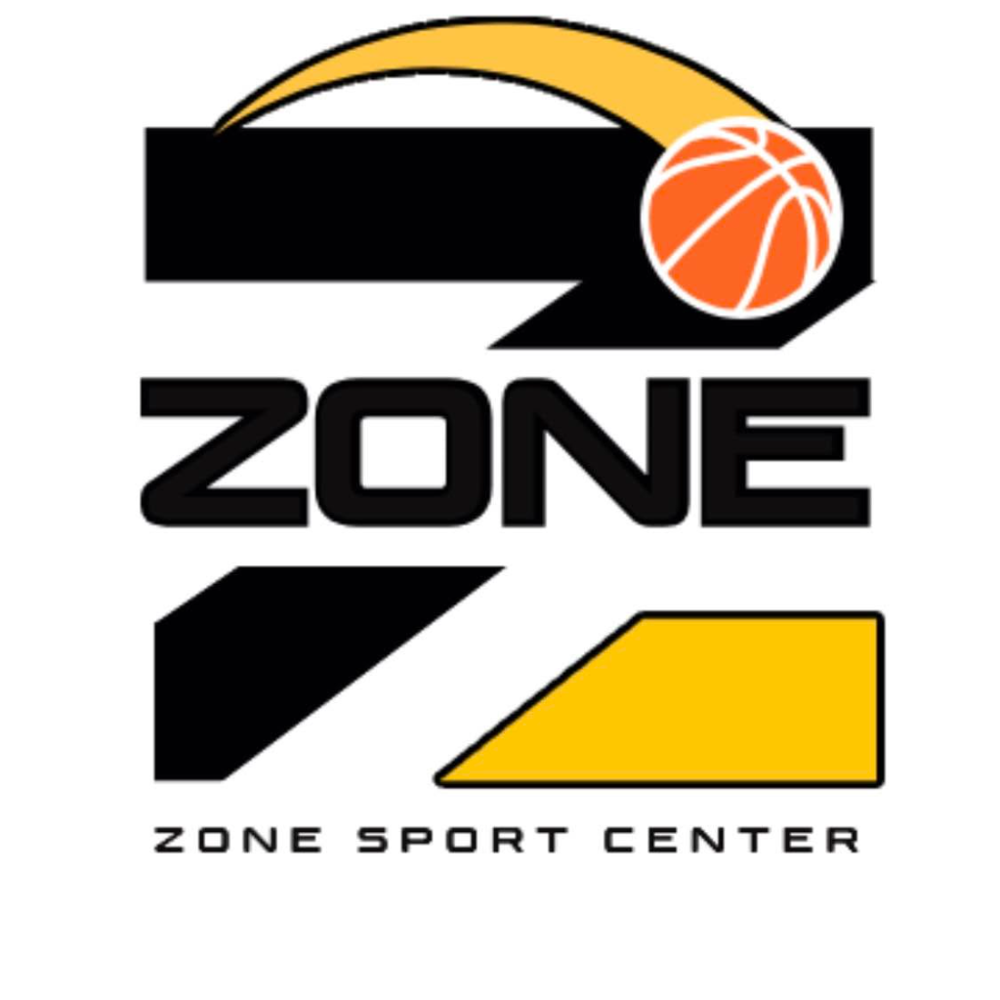

# ZONE SPORT CENTER - BASKETBALL TRAINING CENTER MANAGEMENT SYSTEM
> Professional Basketball Training Center Management Web Application (Python / Flask - Zero Database Installation Required)



---

## 🏀 SYSTEM OVERVIEW
**ZONE SPORT CENTER** is a comprehensive basketball training management web system built with Python and Flask. Designed in a bold **Black & Gold Arena Sports theme** (with basketball orange accents), it brings modern, athletic, high-contrast aesthetics and full responsive support.

The system utilizes an **In-Memory & JSON Data Store** (`data/database.json`), allowing it to run instantly **without configuring any external database engines** (MySQL, SQL Server, PostgreSQL, or SQLite).

---

## ⚡ QUICK START GUIDE

### 1. Requirements
- Python 3.10+ (already installed on your machine)
- Flask library:
```bash
pip install flask
```

### 2. Run the Application
Open PowerShell / Command Prompt in this folder and run:
```bash
python app.py
```
Then open your web browser and navigate to: **[http://127.0.0.1:5000](http://127.0.0.1:5000)**

### 3. Run Unit Tests
To run the automated test suite covering all 7 modules:
```bash
python test_app.py
```

---

## 🔑 DEFAULT DEMO ACCOUNTS

Pre-configured accounts (with one-click auto-fill buttons on the login screen):

| Role | Username | Password | Permissions |
|---|---|---|---|
| **Admin (Administrator)** | `admin` | `admin123` | Full system access: Students, Coaches, Classes, Enrollments, Tuition & Payments, Reports & Analytics, Reset Data |
| **Coach (Head Coach)** | `coach_nam` | `coach123` | View assigned classes, student rosters, practice attendance tracking, profile settings |
| **Coach (Assistant Coach)** | `coach_hoang` | `coach123` | Assigned classes, student rosters, attendance tracking |

---

## 🚀 KEY FEATURES & MODULES

### 1. User Authentication & Profile
- Secure session-based authentication & logout.
- Role-based permissions (**Admin** vs. **Coach**).
- Change password with confirmation validation.
- User profile updates (Full Name, Phone, Email, Coaching Philosophy/Bio).

### 2. Dashboard Command Center
- Core metrics: **Total Students**, **Total Coaches**, **Training Classes**, **Total Enrollments**.
- Live tuition collected, outstanding debt, and attendance rate counters.
- Interactive Chart.js charts: **Student Enrollment by Class** and **Level Distribution**.
- Recently joined students and class capacity fill indicators.

### 3. Student Management
- Full student directory with search by **Name**, **Phone**, or **ID**.
- Student registration & edit profiles.
- Safe student deletion with confirmation modal.
- Detailed student profiles: automatic age calculation from DOB, enrolled classes list, and tuition payment history.

### 4. Coach Management
- Professional coaching staff directory.
- Add new coach with **auto-generated system login credentials**.
- Edit specialty, years of experience, and career highlights.
- Coach profiles displaying all classes directly under their leadership.

### 5. Class Management
- Manage classes by level: **Beginner**, **Intermediate**, **Advanced**.
- Assign coaches, court locations, and weekly training schedules.
- Set seat capacity limits, tuition fees, and live capacity progress bars.
- Detailed class rosters with student attendance shortcuts.

### 6. Enrollment Management
- Enroll students into training classes with duplicate prevention.
- Enforce maximum student capacity limits with automated warnings.
- Auto-generate tuition invoice upon enrollment.
- Enrollment cancellation with safety confirmation.

### 7. Tuition & Payment Management
- Real-time tuition payment ledger with search & status filters.
- Categorization: **Paid** (completed) / **Unpaid** (outstanding balance).
- Record payments and update payment methods (Cash, QR Transfer, POS Card).
- Financial overview cards for collected revenue, pending debt, and receivable totals.

### 8. Attendance & Practice Tracking
- Filter by class and date to take practice roll calls.
- Track status per student: **Present**, **Excused**, **Absent**.
- Convenient "Mark All Present" one-click button.
- Live calculation of overall center attendance consistency.

### 9. Comprehensive Reports & Analytics
- Monthly activity breakdown tables for 2026.
- Interactive Chart.js monthly revenue curve.
- Class student distribution pie chart.
- Printable report layout for administrative records.

---

## 🎨 UI & DESIGN SYSTEM
- **Language**: 100% English interface across all views, modals, forms, and alerts.
- **Layout**: Fixed vertical left sidebar navigation with mobile responsive drawer toggle.
- **Sports Arena Theme**: High-contrast black (`#090b0e`, `#161b24`), vibrant gold (`#ffb703`, `#ffc107`), and athletic basketball orange (`#ff5e00`).
- **Typography**: Clean `Be Vietnam Pro` font for high legibility.
- **Table Visibility**: Fully customized dark theme table styling (`.table-zone`) ensuring all text, rows, and links are clearly visible by default without requiring mouse hover.
